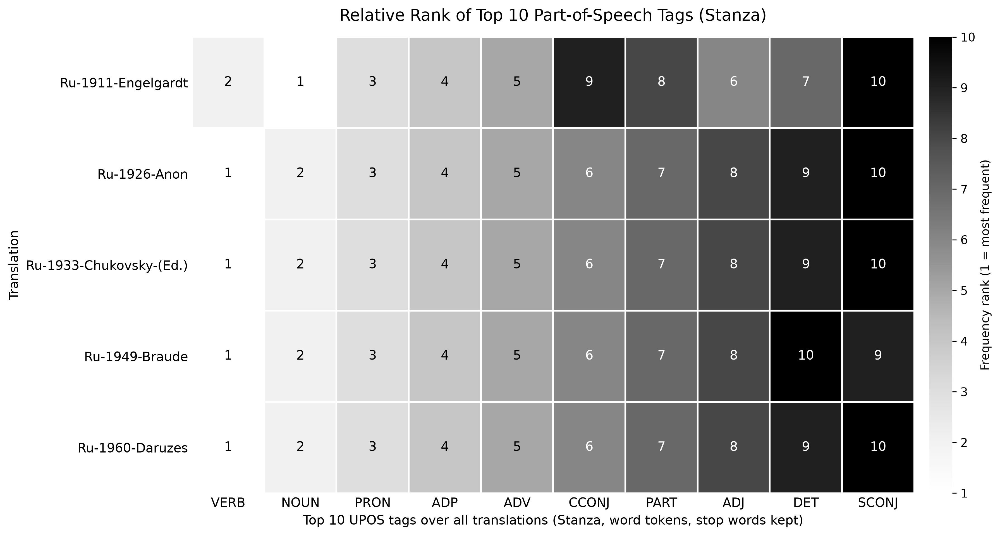
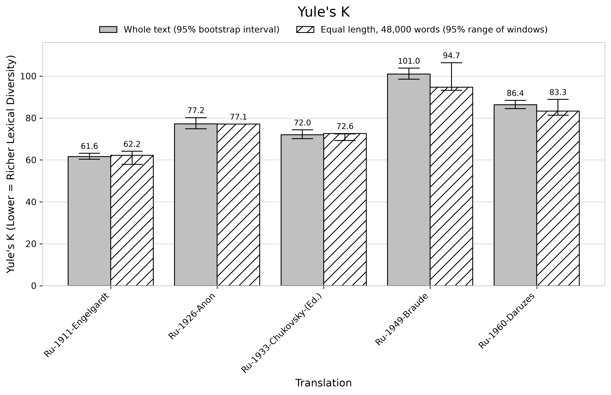
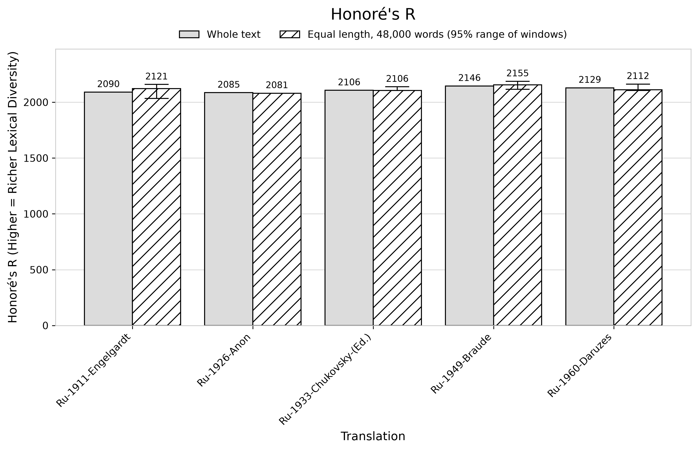
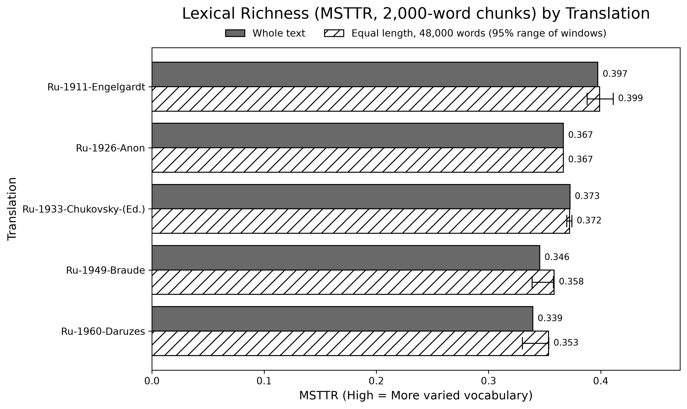
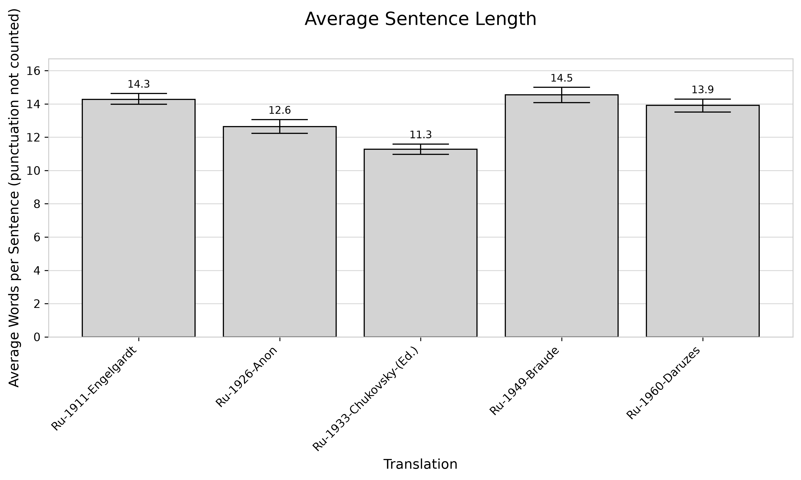
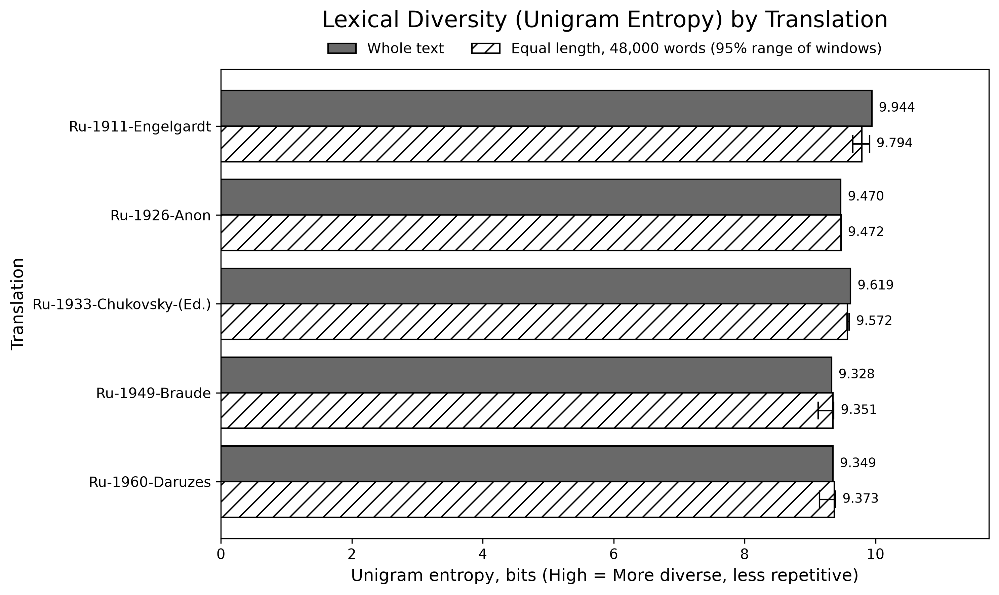

# Amendment Report: Rebuilt Pipeline for *Comparative Stylometric Analysis of Mark Twain's "The Adventures of Huckleberry Finn" Russian Translations*

**Vix Talbot**
10-2026 (last updated 2026-10-26)

Companion to *Final Report 3*¹ (11-2025). This is a living report: a section is added at the end of
each pipeline stage, and the Executive Summary is updated with it.

---

## 1. Executive Summary

We rebuilt the analysis behind *Final Report 3* as a reproducible pipeline. Five stages are
complete: the data audit with text preparation, an audit of the previous motif results,
tokenization with part-of-speech tagging, network construction, and the classic stylometric
measures.

**Text preparation** changes how the article should describe its data. The 1911 Engel'gardt text (Ru-1911) contains OCR damage, mainly words split by stray
spaces. We repaired it, which reduces its vocabulary by 382 word types (1.8%). In the other four
texts the change is at most 43 types (0.3%). We also found that the old cleaning step deleted the
letter ё and fused hyphenated words, and we have replaced it. All article numbers are recomputed in
the stages that follow, and each stage will report its old and new values.

**The motif audit** confirms that Figure 9 comes from one specific mfinder run: all 65 values match.
It also corrects four statements in the article:

- The archived outputs contain two mfinder runs from 2025 on identical input networks and settings.
  Their Z-scores differ by up to 1.52 for the same motif and text, which reflects run-to-run
  randomization noise.
- Braude's network is not the largest, so network size does not explain its large Z-scores.
- mfinder does not use edge weights.
- mfinder's motif member lists are partial samples. It does not erase them.

These need wording changes in the Data Pipeline section, §3.4.1 and §3.5. The motif figures
(Figures 9–11) will be regenerated in the Motif Analysis stage.

**Part-of-speech tagging changes a finding.** The article reports that the 1960 Daruzes translation
is the only one to rank verbs above nouns (Figure 6). With every word tagged in context, stop words
kept, and two independent taggers, Daruzes does rank verbs above nouns, but so do the 1926, 1933 and
1949 translations. The 1911 Engel'gardt translation is the only one in which nouns outnumber
(lexical) verbs; if the auxiliary «быть» is counted as a verb, verbs lead in all five. Daruzes has
the lowest noun-to-verb ratio of the five (0.81), with Braude next (0.85), but paragraph-bootstrap
95% confidence intervals show the two cannot be told apart. The shift from 1911 to 1960 towards
finite verbs and away from participles and verbal adverbs holds well outside the intervals. Figure 6
is replaced, and §3.2.2, the Executive Summary and the Discussion need revised text.

**Classic stylometric measures confirm the richness ranking but change two findings.**
Engel'gardt's vocabulary is the richest of the five on every length-robust measure: MSTTR, MATTR,
MTLD, HD-D, Yule's K and entropy, on whole texts and on 48,000-word samples alike. The abridged
translations come next, and Braude and Daruzes are the least rich. Honoré's measure (correctly
called R, not W) no longer ranks the abridged 1926 translation richest; that translation now comes
last. But R barely separates the five translations and agrees with no other measure, so the article
should stop using it to rank them. Average sentence length, counted in words without punctuation
marks, is 11.3–14.5 words rather than 15–20. Braude, Engel'gardt and Daruzes cannot be told apart,
so the claim that the later translations have the longest sentences is withdrawn. The abridged
translations remain clearly shorter. Figures 1–5 are replaced, and §3.1 and §3.2.1–3.2.2 need
revised text (Section 7).

**Network construction** now keeps edges inside sentences. The old networks linked the last word of
each sentence to the first word of the next. Removing those links removes 9–11% of the edges in
every translation. Node counts change by −4% to +2%, mostly from the new lemmatizer, and Braude's
network still ranks third by size. The motif counts are now computed exactly in Python by two
libraries that agree on every value, with mfinder 1.2 kept as a cross-check, using a recorded random
seed. The motif and centrality values are recomputed in the next stages. For this stage only the
article's description of the network changes (Data Pipeline, §3.4).

**Motif analysis (preliminary, Ru-1911 only, 100 random networks).** On the new network no motif
changes sign relative to Figure 9. Two motifs that were not significant in Figure 9 (74 and 108) now
are, and the significance profile keeps its shape. The final run uses 1,000 random networks for all
five translations (Section 10).

### Changes at a glance

| Stage | Change | Impact level | Article section affected |
|---|---|---|---|
| Data Audit and Text Preparation | Input handling: byte-order mark removed, line endings normalized | None | — |
| Data Audit and Text Preparation | Orthography checked: all five texts use modern spelling, no conversion needed | None | — |
| Data Audit and Text Preparation | OCR repair: split words rejoined (mainly Ru-1911), Latin look-alike letters replaced, broken hyphenation rejoined | Wording | Data Pipeline |
| Data Audit and Text Preparation | Nine inline editorial notes removed from Ru-1911 | Wording | Data Pipeline |
| Data Audit and Text Preparation | Twain's Notice (Ru-1911, Ru-1960) and Explanatory note (Ru-1960) removed | Wording | Data Pipeline |
| Data Audit and Text Preparation | Dashes, quotation marks and ё normalized | Wording | Data Pipeline |
| Data Audit and Text Preparation | Old cleaning step deleted ё and fused hyphenated words; replaced | Wording | Data Pipeline ("Distinct Full Datasets") |
| Audit of Previous Motif Results | Figure 9 traced to one mfinder run (65 of 65 values match) | None | §3.4.1, Figure 9 |
| Audit of Previous Motif Results | Two archived 2025 mfinder runs with identical inputs and settings differ by up to 1.52 in Z | Wording | §3.4.1 |
| Audit of Previous Motif Results | Braude's network ranks 3rd of 5 by edges; the "more connections" explanation is withdrawn | Wording | §3.4.1 (Figure 9 discussion) |
| Audit of Previous Motif Results | mfinder ignores edge weights | Wording | Data Pipeline; §3.4.1 |
| Audit of Previous Motif Results | Motif member lists are partial samples from a different run | Wording | §3.5 |
| Tokenization and Tagging | POS tagging: pymorphy2 on lemmas without stop words → Stanza in context on the full text, cross-checked with spaCy | Finding | §3.2.2, Figure 6; Executive Summary; Discussion |
| Tokenization and Tagging | Verbs outrank nouns in Ru-1926, Ru-1933, Ru-1949 and Ru-1960; the Daruzes "inversion" is not unique | Finding | §3.2.2, Figure 6; Executive Summary; Discussion |
| Tokenization and Tagging | Bootstrap 95% CIs: Daruzes and Braude not distinguishable on NOUN : VERB; verb lead in Ru-1926 and Ru-1933 not established under spaCy; 1911→1960 verb-form trend holds | Finding | §3.2.2; Executive Summary; Discussion |
| Tokenization and Tagging | Hyphenated words (что-то, мало-помалу) kept as single tokens | None | — |
| Network Construction | Edges restricted to sentences (old: across sentence boundaries); 9–11% fewer edges | Wording | Data Pipeline; §3.4 |
| Network Construction | Nodes are Stanza lemmas (ё → е); node counts −4% to +2% | Wording | §3.4 |
| Network Construction | Exact motif counts in Python (igraph = networkx); mfinder 1.2 kept as cross-check with a recorded seed | None | — |
| Network Construction | Roman numerals (XVI, III in regnal names) treated as numbers, not words; 1–7 edges per translation | None | — |
| Audit of Previous Motif Results | mfinder's clock seeding on 64-bit machines never initialized its generator, so the 2025 runs cannot be repeated; new runs use a recorded seed | Wording | §3.4.1 |
| Classic Stylometric Measures | Measures on Stanza lemmas with stop words kept (content-word view alongside); MATTR, MTLD, HD-D added; values change, order of the five essentially unchanged | Numbers | §3.1, §3.2.1–3.2.2; Figures 1, 3, 5 |
| Classic Stylometric Measures | Equal-length (48,000-word) samples: Engel'gardt's richness lead and the Yule's K order hold | Wording | §3.1, §3.2.1 |
| Classic Stylometric Measures | Honoré's "W" renamed R; Ru-1926 no longer highest (now lowest); R barely separates the texts and is dropped from the ranking | Finding | §3.1, Figure 2 |
| Classic Stylometric Measures | Sentence length without punctuation (11.3–14.5 words); Braude, Engel'gardt, Daruzes not distinguishable; abridged texts shorter | Finding | §3.2.1, Figure 4 |
| Classic Stylometric Measures | Bootstrap intervals for sentence length, K and HD-D; paragraph bootstrap found biased for MSTTR, MATTR, MTLD, R, entropy | Wording | §3.1, §3.2.1 |
| Classic Stylometric Measures | Old fusion of hyphenated words moves no measure by more than 0.4% | None | — |
| Motif Analysis (preliminary) | Ru-1911, 100 random networks: no sign changes vs Figure 9; motifs 74 and 108 become significant | To be decided | §3.4.1, Figures 9–10 |

---

## 2. Purpose of the Amendment

Before submission, we rebuilt the analysis as a reproducible pipeline. It has a pinned software
environment, a single configuration file for every parameter, seeded randomness, automated tests and
one command to run each stage. With these, peer reviewers can clone the repository and reproduce
every result in the article.

Reviewing each step during the rebuild turned up a number of corrections. This report documents
them stage by stage. For each correction it gives the old value or practice, the new one and the
reason, so that the article can be brought in line with the rebuilt pipeline before submission.

---

## 3. How to Read This Report

Every change is assigned one impact level:

| Impact level | Meaning |
|---|---|
| **None** | Internal change, no effect on the article. |
| **Wording** | A sentence or description in the article should be adjusted. Suggested replacement text is provided. |
| **Numbers** | Reported values change, but the interpretation does not. |
| **Figure** | A figure needs replacing. |
| **Finding** | An interpretation or conclusion changes. |

Each stage section lists what changed (old → new), why, the effect (with an old-versus-new table
where there are numbers), the impact level and, for Wording or higher, suggested article text.
Translations are referred to by the article's labels (Ru-1911-Engelgardt, etc.). Section and figure
numbers refer to *Final Report 3*.

---

## 4. Data Audit and Text Preparation

### 4.1 Input handling

**What changed.** We now read every raw file as UTF-8 with its byte-order mark removed. All five
files have one. Windows line endings (CRLF) are normalized to `\n` in memory, and the raw files are
never modified. A paragraph is one non-empty line, which the audit confirmed for all five texts.

**Why.** An unremoved byte-order mark becomes an invisible character attached to the first word of
the text. Fixing these rules makes every later count well defined.

**Effect.** No measurable effect on word counts.

**Impact level: None.**

### 4.2 Orthography

**What changed.** Nothing. We checked whether any text, in particular the 1911 translation, uses
pre-1918 spelling.

**Why.** Old spelling (ѣ, і, ѳ, ѵ, final ъ, endings such as -аго) would split one word into two
spellings and inflate the vocabulary of the older texts.

**Effect.** None of the five texts contains ѣ, і, ѳ or ѵ. Final ъ occurs once in Ru-1926 and once in
Ru-1933, both OCR errors. All three -аго matches in Ru-1911 are OCR splits of modern words (e.g.
«благо душествовали»), and Ru-1926 has two isolated old-style forms («животныя»). Ru-1911 uses
modern orthography, so no spelling conversion was needed.

**Impact level: None.**

### 4.3 OCR repair

**What changed.** Old: OCR errors were not repaired. New: three kinds of OCR damage are
repaired, each by a fixed rule, and every change is logged.

- *Split words.* A word broken by a stray space (e.g. «толь ко» for «только») is rejoined when the
  joined form is a word in the pymorphy3 Russian dictionary⁴ and at least one half is not. If both
  halves are dictionary words (e.g. «по том»), they are joined only when the joined form occurs as
  one word at least twice in the same translation, the split pair occurs in none of the other four,
  and neither half is a single letter. Neither rule joins after «не» or «ни», or before a capital
  letter.
- *Latin look-alikes.* Latin letters that look like Cyrillic ones (a, c, o, p, …) inside Cyrillic
  words are replaced by their Cyrillic counterparts. In Russian text, `c` is the Latin letter, not
  the Cyrillic «с».
- *Broken hyphenation.* Hyphenated words broken by a space (e.g. «кое- что», «из- под»,
  «какая- нибудь») are rejoined.

**Why.** Each split word counts as two spurious words, which inflates vocabulary-based measures such
as type counts and the type–token ratio. It also adds false edges to the word-adjacency network.
Ru-1911, an OCR scan, is the most affected.

**Effect.** Changes per text:

| Repair | Ru-1911 | Ru-1926 | Ru-1933 | Ru-1949 | Ru-1960 |
|---|---|---|---|---|---|
| Split words rejoined (dictionary rule) | 92 | 0 | 1 | 0 | 0 |
| Split words rejoined (within-text attestation rule) | 434 | 2 | 1 | 4 | 4 |
| Latin look-alike letters replaced | 2 | 1 | 1 | 0 | 1 |
| Broken hyphenation rejoined | 0 | 2 | 22 | 3 | 40 |

Word tokens and word types (lowercased) in the raw and fully prepared texts, after all steps in
Section 4:

| Translation | Tokens, raw | Tokens, prepared | Types, raw | Types, prepared | Δ types | Δ types % |
|---|---|---|---|---|---|---|
| Ru-1911-Engelgardt | 115,056 | 114,427 | 20,876 | 20,494 | −382 | −1.8% |
| Ru-1926-Anon | 48,208 | 48,208 | 10,291 | 10,288 | −3 | −0.0% |
| Ru-1933-Chukovsky-(Ed.) | 63,217 | 63,194 | 12,689 | 12,683 | −6 | −0.0% |
| Ru-1949-Braude | 91,768 | 91,761 | 14,939 | 14,936 | −3 | −0.0% |
| Ru-1960-Daruzes | 92,298 | 92,136 | 14,399 | 14,356 | −43 | −0.3% |

Here a word token is a run of Cyrillic letters, with internal hyphens joining the parts. This is the
same definition for raw and prepared text, so the table isolates the effect of preparation. Of the
382 types removed in Ru-1911, 220 come from the attestation rule. We checked a seeded random sample
of 40 of those joins by hand, and all 40 were genuine OCR splits.

**Impact level: Wording.** See the suggested paragraph in 4.8.

### 4.4 Editorial notes

**What changed.** Old: Ru-1911 contained nine bracketed editorial notes inside the narrative, marked
«Прим.», and they were analysed as Twain's text. New: they are removed. All other bracketed passages
are kept and listed for review. None remain in any text.

**Why.** The notes are commentary added by the editor or translator, not part of the translation.

**Effect.** 9 notes removed from Ru-1911. None in the other texts.

**Impact level: Wording.** See 4.8.

### 4.5 Twain's Notice and Explanatory note

**What changed.** Old: Twain's prefatory Notice was included in Ru-1911 and Ru-1960, and his
Explanatory note in Ru-1960. New: both are removed wherever they appear. They are matched on their
text, never on line numbers.

**Why.** Comparability. Ru-1926, Ru-1933 and Ru-1949 contain neither passage, so keeping them would
give two translations text the others lack.

**Effect.**

| Translation | Removed | Raw lines |
|---|---|---|
| Ru-1911-Engelgardt | Notice | 1 |
| Ru-1960-Daruzes | Notice; Explanatory note | 1–3; 4–7 |

Closing lines such as «Конец» or the signature «Гек Финн» are left in place.

**Impact level: Wording.** See 4.8.

### 4.6 Dashes, quotation marks and ё

**What changed.** New: punctuation is normalized to one form per mark. Double hyphens and spaced
dashes become an em dash, all quotation styles become « », and runs of three or more full stops
become an ellipsis. Whitespace is normalized. ё is written as е throughout.

**Why.** The five editions use different typographic conventions. Ru-1911, for example, uses `--`
for dashes and straight `"` quotes, the others em dashes and « ». Sentence splitting and
average sentence length depend on these marks. ё is used inconsistently (0.02 to 0.35 per 1,000
words), so «все» and «всё» would otherwise count as different words in some editions and not in
others.

**Effect.**

| Normalization | Ru-1911 | Ru-1926 | Ru-1933 | Ru-1949 | Ru-1960 |
|---|---|---|---|---|---|
| Punctuation changes | 2,352 | 155 | 520 | 121 | 204 |
| ё → е | 4 | 1 | 22 | 3 | 23 |

**Impact level: Wording.** See 4.8.

### 4.7 The old cleaning step

**What changed.** Old: the text was lowercased and then cleaned with the regular expression
`[^а-я\s]` (`01dataprep_clean_lemmatize.py`), which deletes every character outside а–я and
whitespace. New: the rules in 4.1–4.6, with ё kept until it is mapped to е and hyphenated words kept
as single words.

**Why.** ё lies outside the range а–я, so the old expression deleted it rather than converting it.
«её» became «е» and «ещё» became «ещ». The hyphen was deleted too, so hyphenated words were fused:
«кое-что» became «коечто» and «по-моему» became «помоему». These fused forms are not dictionary
words, so lemmatization could not recover them.

**Effect.** Raw-text occurrences affected by the old expression:

| | Ru-1911 | Ru-1926 | Ru-1933 | Ru-1949 | Ru-1960 |
|---|---|---|---|---|---|
| Words containing ё (letter deleted) | 4 | 1 | 22 | 3 | 23 |
| Hyphenated words (fused) | 1,078 | 397 | 538 | 855 | 1,143 |

Each fused form (e.g. «коечто», «когото») is a word that does not exist in Russian. The old
lemmatizer (pymorphy2) cannot find it in its dictionary, so inflected forms of the same hyphenated
word are not reliably grouped under one lemma. The fusion therefore changes the old type counts of
all five texts: 1,078 fused hyphenated words in Ru-1911, 397 in Ru-1926, 538 in Ru-1933, 855 in
Ru-1949 and 1,143 in Ru-1960. Their effect on the lexical-richness numbers is quantified in Section 7.3: replacing
every hyphenated word with its fused form moves no measure by more than 0.4% and changes no ranking,
so the impact level below stands.

**Impact level: Wording.** The article's description of "clean" data in "Distinct Full Datasets"
should describe the new procedure (see 4.8).

### 4.8 Suggested article text

Add the following paragraph to the **Data Pipeline** section, under "Distinct Full Datasets", in
place of the sentence beginning "For the purposes of the report 'clean' data …":

> **Text preparation.** Before any measurement, the five raw texts were prepared by a fixed sequence
> of rules, each change logged and reproducible from the project repository. Files were read as
> UTF-8, with the byte-order mark removed and line endings normalized; each line is one paragraph.
> All five texts, including the 1911 translation, use modern Russian orthography, so no spelling
> conversion was needed. The Engel'gardt text (Ru-1911) was digitized by optical character
> recognition and contains words split by stray spaces (e.g. «толь ко» for «только»). We rejoined
> these using the pymorphy3 Russian morphological dictionary (Korobov 2015) and, where both halves of a split are
> themselves words, only when the joined form occurs elsewhere in the same translation and the split
> form occurs in none of the others. We also replaced Latin look-alike letters inside Cyrillic words
> and rejoined hyphenated words broken by a space. Nine editorial notes inside the Ru-1911 narrative
> were removed, as were Twain's Notice (Ru-1911, Ru-1960) and Explanatory note (Ru-1960), which the
> other translations do not include. Dashes, quotation marks and ellipses were normalized, ё was
> written as е throughout, and hyphenated words (e.g. «кое-что») were kept as single words. These
> steps reduced the vocabulary of Ru-1911 by 382 word types (1.8%) and of the other translations by
> at most 43 types (0.3%). Lowercasing, lemmatization and stop-word removal follow as described
> below.

Add Korobov (2015)⁴ to the article's bibliography.

---

## 5. Audit of Previous Motif Results

This section audits the mfinder outputs behind §3.4.1 and §3.5 as they stand in the archived
repository (tag `report-v3`). It does not recompute any motif statistics; the rebuilt motif analysis
is reported in Section 10.

### 5.1 Source of Figure 9

**What changed.** Nothing in the values. We identified which mfinder output produced Figure 9.

**Why.** The archived outputs contain two mfinder runs from 2025 on identical input networks and
settings (100 randomizations): the run behind Figure 9 (`*_input_OUT.txt`, Aug–Oct 2025) and a second
run (`*_stats_OUT.txt`, Oct 23–25, 2025). Each run drew its own random networks.

**Effect.** We compared all 65 values in Figure 9 (13 motifs × 5 translations) with both runs, after
rounding to two decimals:

| mfinder run | Values matching Figure 9 |
|---|---|
| `input_OUT` | 65 / 65 |
| `stats_OUT` | 2 / 65 |

Figure 9 is the `input_OUT` run.

**Impact level: None.**

### 5.2 Run-to-run variation of Z-scores

**What changed.** Old: the article presents the Z-scores as fixed values. New: we report that they
come from a single run of mfinder with 100 random networks and that the archived outputs show how
much they vary between runs. No new mfinder run was made for this section.

**Why.** mfinder estimates each Z-score from randomized networks³, so runs with the same input and
settings give different values. The archived outputs contain two mfinder runs from 2025 on identical
input networks and settings (3-node motifs, 100 randomizations): the run behind Figure 9
(`_input_OUT`, Aug–Oct 2025) and a second run (`_stats_OUT`, Oct 23–25, 2025). Their Z-scores differ
by up to 1.52 for the same motif and text, which reflects run-to-run randomization noise.

Neither run can be repeated. The original mfinder 1.2 seeds its random generator from the clock in a
way that, on 64-bit machines, never runs the generator's setup step, so the randomization of the 2025
runs cannot be reproduced. The rebuilt pipeline patches mfinder to take an explicit seed, which is
recorded with every run (`tools/mfinder/seed.patch`; Section 9.3).

**Effect.** Largest absolute difference between the two archived 2025 runs, over the 13 motifs:

| | Ru-1911 | Ru-1926 | Ru-1933 | Ru-1949 | Ru-1960 |
|---|---|---|---|---|---|
| max \|ΔZ\| | 1.46 | 0.43 | 1.41 | 1.27 | 1.52 |

The figure stars a value when |Z| > 2.0. Exactly one cell changes status between the two archived
runs: Ru-1949, motif 110 (Z = 1.82 in Figure 9, 2.07 in the `_stats_OUT` run).

**Impact level: Wording.**

**Suggested article text.** §3.4.1 now says: "Then it creates 100 simulations while preserving the
exact node, edge, and degree counts of the original text but randomly shuffles the specific
connections between words." Add after it:

> The Z-scores in Figures 9–11 come from a single mfinder run with 100 random networks. Because the
> random networks differ between runs, so do the Z-scores: a second run made in 2025 on the same
> networks with identical settings gave values that differ by up to 1.5 for the same motif and
> translation.

The Figure 9 discussion now says: "This step remains necessary however, as it's part of calculating
the raw z-scores with a 95% confidence interval which tells us which outcomes are statistically
significant. The star following a z-score tells you if it is one of the significant scores." Replace
with:

> A star marks a Z-score with |Z| > 2.0, roughly the two-sided 5% level under a normal approximation.

### 5.3 Network size and Braude's Z-scores

**What changed.** Old: the article attributes the size of Braude's Z-scores to network size. New:
that explanation is withdrawn.

**Why.** Braude's network is not the largest. Network sizes from the archived mfinder input files:

| Rank by edges | Translation | Nodes | Edges | Edges per node | Total edge weight |
|---|---|---|---|---|---|
| 1 | Ru-1911-Engelgardt | 9,822 | 67,577 | 6.88 | 114,962 |
| 2 | Ru-1960-Daruzes | 7,335 | 51,216 | 6.98 | 92,108 |
| 3 | Ru-1949-Braude | 7,634 | 49,719 | 6.51 | 91,533 |
| 4 | Ru-1933-Chukovsky-(Ed.) | 6,665 | 40,160 | 6.03 | 62,997 |
| 5 | Ru-1926-Anon | 5,836 | 31,254 | 5.36 | 47,758 |

Braude ranks third by edges, by edges per node and by total edge weight, and second by nodes.

**Effect.** The values in Figure 9 are unchanged. Only the explanation offered for them is affected.

**Impact level: Wording.**

**Suggested article text.** In the Figure 9 discussion, replace "This is because that network
contains more connections overall." with:

> This is not a matter of network size: by number of connections, Braude's network ranks third of
> the five, behind Engel'gardt and Daruzes.

In the Discussion table, the description of the Raw Motif Z-Score Heatmap ("while being influenced
by network size") can stay. Raw Z-scores do depend on network size in general, which is why the
article normalizes them in Figure 10 using the significance profile of Milo et al.⁵

### 5.4 Edge weights

**What changed.** Old: the article describes edge weights as part of the network mfinder analyses. New:
we state that mfinder counts motifs on the unweighted network.

**Why.** The mfinder input files carry bigram counts as a third column (from 1 to 298). The mfinder
1.2 manual, §2.4, states: "In the current version <edge weight> is ignored and should be 1 for all
edges."² The manual documents no option for using weights, and the old command
(`mfinder <input> -s 3 -r 100 -omem -f <output>`, in `18run_mfinder.sh`) passed none. Motif counts and
Z-scores therefore depend only on which directed edges exist, not on how often each was traversed. The rebuilt
pipeline sets motif edge weights to 1 and keeps bigram counts only where a weighted measure uses them.

**Effect.** None on the archived values, which were computed as mfinder computes them. Only the
description is affected.

**Impact level: Wording.**

**Suggested article text.** In the **Data Pipeline** section, replace "An edge that's traversed often,
like "Huck" following "and" becomes a very thick, strong line." with:

> We record how often each edge is traversed, so that "Huck" following "and" 500 times gives an edge
> of weight 500; the motif analysis uses only whether an edge exists, not its weight.

In §3.4.1, replace "Mfinder … takes our raw text line of the translation's graphs that we have
compiled into a dataset, where a connection like "Huck" to "and" that appears say 500 times, becomes
a simple line of code, 1 2 500." with:

> mfinder takes each translation's network as a list of directed edges between numbered words. It
> counts motifs on the unweighted network: an edge is either present or absent, however often the
> word pair occurs.

### 5.5 Motif member lists

**What changed.** Old: §3.5 states that mfinder erases which words make up each motif occurrence.
New: mfinder can write member lists (option `-omem`), and the archived repository contains them, but
they are partial.

**Why.** Each member file is headed "Partial list of N members". N is identical in all five
translations for every motif (e.g. 1,001 for motif 238, 6,006 for motif 38), whereas the real motif
counts run into the thousands to millions. So the lists are fixed-size samples, not complete
inventories. They also come from the `stats_OUT` run, not the `input_OUT` run behind Figure 9.

**Effect.** None on any reported value. The article does not use the member lists.

**Impact level: Wording.**

**Suggested article text.** In §3.5, replace "Unfortunately, mfinder explicitly erases this
information instead of caching it somewhere that I could pull out." with:

> mfinder can list the members of each motif, but only as a partial sample of fixed size, so it
> cannot give a complete count of which word triples make up each motif.

### 5.6 Motif figures

Figures 9, 10 and 11 will be regenerated from the rebuilt networks in the Motif Analysis stage
(Section 10). The changes in this section concern the article's wording only.

---

## 6. Tokenization and Tagging

### 6.1 What changed

**Old.** Part-of-speech tags came from pymorphy2, a dictionary-based analyser that tags each word in
isolation, without its sentence. It was run on the lemmatized text with stop words removed
(`Ru#_clean_lemmatized_nostops.txt`, script `03feature_extraction.py`). Because the input was
lemmas, every verb had already been reduced to its infinitive, so finite verbs were counted under
the infinitive tag INFN. §3.2.2 states that stop words were retained for the part-of-speech
analysis, but the code used the file without them.

**New.** Every paragraph of the prepared text is tokenized, split into sentences, tagged and
lemmatized by Stanza⁶ (version 1.15.0, Russian models trained on the UD SynTagRus treebank), with
each word tagged in its sentence. Tags follow the Universal Dependencies (UD) scheme⁸. Stop words are
kept. As a cross-check, spaCy⁷ (version 3.8.16, model `ru_core_news_lg` 3.8.0) tags exactly the same
tokens. Hyphenated words (что-то, мало-помалу, Взгляни-ка) are kept as single tokens. Stanza's
tokenizer splits 12–21% of them, and these pieces are merged before tagging. Every character of the
prepared text is accounted for in the tokens, which an automated check confirms.

### 6.2 Why

Tagging a lemma rather than the word in its sentence discards the information that decides many tags
(case, tense, whether «было» is a verb or an auxiliary). It also turns every finite verb into an
infinitive. A part-of-speech profile meant to capture the translator's grammar needs every word,
including function words, tagged in context. A second tagger shows which results depend on the
choice of tagger.

### 6.3 Effect

Old ranks (Figure 6, pymorphy2 tags on lemmas without stop words):

| Translation | NOUN | INFN |
|---|---|---|
| Ru-1911-Engelgardt | 1 | 2 |
| Ru-1926-Anon | 1 | 2 |
| Ru-1933-Chukovsky-(Ed.) | 1 | 2 |
| Ru-1949-Braude | 1 | 2 |
| Ru-1960-Daruzes | 2 | 1 |

New ranks and proportions of word tokens (stop words kept):

| Translation | Stanza: NOUN rank | Stanza: VERB rank | Stanza: NOUN | Stanza: VERB | Stanza: NOUN : VERB | spaCy: NOUN rank | spaCy: VERB rank | spaCy: NOUN : VERB |
|---|---|---|---|---|---|---|---|---|
| Ru-1911-Engelgardt | 1 | 2 | 19.8% | 18.9% | 1.048 | 1 | 2 | 1.071 |
| Ru-1926-Anon | 2 | 1 | 18.4% | 19.4% | 0.949 | 2 | 1 | 0.979 |
| Ru-1933-Chukovsky-(Ed.) | 2 | 1 | 18.8% | 19.7% | 0.954 | 2 | 1 | 0.986 |
| Ru-1949-Braude | 2 | 1 | 16.6% | 19.6% | 0.846 | 2 | 1 | 0.871 |
| Ru-1960-Daruzes | 2 | 1 | 16.3% | 20.1% | 0.811 | 2 | 1 | 0.847 |

In UD, «быть» used as a copula or auxiliary is tagged AUX, not VERB. Counting AUX with VERB lowers
every ratio (Stanza: 0.965, 0.860, 0.874, 0.771, 0.750; spaCy: 0.983, 0.885, 0.900, 0.790, 0.782).
The order of the five translations is unchanged, but Ru-1911 then also has more verbs than nouns
(Stanza; under spaCy its interval, 0.961–1.005, includes parity), so with auxiliaries included verbs
outnumber nouns in every translation.

**Does Daruzes still rank verbs above nouns?** Yes, under both taggers. But the article's finding
was that Daruzes is the *only* translation to do so, and that no longer holds. Verbs rank first and
nouns second in all four translations from 1926 to 1960. The 1911 Engel'gardt translation is the
only one with nouns first, and only when lexical verbs (VERB) are counted without the auxiliary
(AUX). Daruzes has the most verb-heavy profile of the five on either count, but it is not
distinguishable from Braude (see Uncertainty below).

Verb forms (Stanza; share of VERB and AUX tokens):

| Translation | Finite | Infinitive | Participle | Converb |
|---|---|---|---|---|
| Ru-1911-Engelgardt | 64.6% | 19.0% | 6.2% | 5.3% |
| Ru-1926-Anon | 71.2% | 16.6% | 5.1% | 3.3% |
| Ru-1933-Chukovsky-(Ed.) | 72.7% | 16.3% | 4.2% | 3.1% |
| Ru-1949-Braude | 76.0% | 16.0% | 2.8% | 1.4% |
| Ru-1960-Daruzes | 77.5% | 14.9% | 1.8% | 1.4% |

spaCy gives the same ordering, within 1.1 percentage points of each value.

**Uncertainty.** We resampled paragraphs with replacement (1,000 resamples, seed 20261022, the same
resampled paragraphs for both taggers) and report percentile 95% confidence intervals. Each cell gives
the point estimate and the interval. Verb-form shares are shares of VERB and AUX tokens.

| Translation | Tagger | NOUN : VERB | NOUN : (VERB + AUX) | Finite | Participle | Verbal adverb |
|---|---|---|---|---|---|---|
| Ru-1911-Engelgardt | Stanza | 1.048 [1.026, 1.070] | 0.965 [0.945, 0.986] | 64.6% [64.0, 65.2] | 6.2% [5.8, 6.7] | 5.3% [5.0, 5.7] |
| Ru-1911-Engelgardt | spaCy | 1.071 [1.048, 1.094] | 0.983 [0.961, 1.005] | 65.7% [65.1, 66.3] | 6.6% [6.1, 7.0] | 5.2% [4.8, 5.5] |
| Ru-1926-Anon | Stanza | 0.949 [0.919, 0.977] | 0.860 [0.833, 0.887] | 71.2% [70.2, 72.2] | 5.1% [4.5, 5.7] | 3.3% [2.9, 3.8] |
| Ru-1926-Anon | spaCy | 0.979 [0.949, 1.011] | 0.885 [0.857, 0.912] | 71.7% [70.8, 72.7] | 5.2% [4.6, 5.7] | 3.2% [2.8, 3.6] |
| Ru-1933-Chukovsky-(Ed.) | Stanza | 0.954 [0.928, 0.980] | 0.874 [0.851, 0.898] | 72.7% [71.9, 73.6] | 4.2% [3.8, 4.6] | 3.1% [2.8, 3.5] |
| Ru-1933-Chukovsky-(Ed.) | spaCy | 0.986 [0.959, 1.013] | 0.900 [0.876, 0.924] | 73.2% [72.4, 74.0] | 4.3% [4.0, 4.8] | 3.1% [2.7, 3.4] |
| Ru-1949-Braude | Stanza | 0.846 [0.824, 0.871] | 0.771 [0.750, 0.792] | 76.0% [75.3, 76.8] | 2.8% [2.4, 3.2] | 1.4% [1.2, 1.6] |
| Ru-1949-Braude | spaCy | 0.871 [0.847, 0.896] | 0.790 [0.769, 0.812] | 76.8% [76.0, 77.5] | 2.8% [2.5, 3.1] | 1.5% [1.3, 1.7] |
| Ru-1960-Daruzes | Stanza | 0.811 [0.787, 0.834] | 0.750 [0.729, 0.772] | 77.5% [76.8, 78.2] | 1.8% [1.5, 2.1] | 1.4% [1.2, 1.6] |
| Ru-1960-Daruzes | spaCy | 0.847 [0.824, 0.871] | 0.782 [0.761, 0.803] | 78.5% [77.9, 79.1] | 2.0% [1.7, 2.3] | 1.5% [1.3, 1.7] |

What the intervals show, taking non-overlapping intervals as the criterion:

- **Daruzes versus Braude: not distinguishable.** Their intervals overlap on both ratios under both
  taggers (e.g. Stanza NOUN : VERB 0.787–0.834 versus 0.824–0.871). Daruzes's lower point estimate
  is within resampling noise.
- **Engel'gardt's noun lead is clear.** Its NOUN : VERB interval lies above 1 under both taggers.
- **The verb lead of the abridged translations depends on the tagger.** Under Stanza the NOUN : VERB
  intervals of Ru-1926 and Ru-1933 lie below 1. Under spaCy they include 1 (0.949–1.011 and
  0.959–1.013), so verbs and nouns are not distinguishable there. For Braude and Daruzes the intervals
  lie below 1 under both taggers.
- **The 1911→1960 verb-form trend holds outside the intervals.** For finite verbs, participles and
  verbal adverbs, the Ru-1911 and Ru-1960 intervals are far apart under both taggers, and every
  consecutive step is separated except two. Ru-1926 and Ru-1933 overlap on all three shares, and
  Braude and Daruzes overlap on verbal adverbs.

Non-overlap of two 95% intervals is a conservative test: intervals that overlap slightly can still
differ at the 5% level. Where we say "not distinguishable" we mean by this criterion.

The two taggers agree on 93.5–95.1% of word tokens in every translation. The most common
disagreements are determiners versus adjectives or pronouns (mostly «который», «сам», «самый»,
«другой»), nouns versus proper nouns, and verbs versus adverbs. NOUN/VERB disagreements make up
0.16–0.22% of word tokens. Full tables: `docs/tagging/tagging_report.md`.

**Figure 6 (replacement).** `docs/amendment/figures/pos_rank_heatmap_stanza.png`

*Figure 6 (replacement): Rank of the ten most frequent UPOS tags in each translation (Stanza, word
tokens, stop words kept; 1 = most frequent). Verbs rank first in every translation except the 1911
Engel'gardt, where nouns do.*

**Sentence and word counts.** Stanza finds 6–8% more sentences in the prepared text than the razdel
splitter found in the raw text during the data audit (e.g. Ru-1911: 8,073 versus 7,593), and its word-token counts are within 0.1% of the audit
definition on the prepared text. Average sentence length (Section 7) uses Stanza's sentences.

**Impact level: Finding** (and Figure: Figure 6 is replaced).

### 6.4 Suggested article text

**§3.2.2, Parts-of-Speech Analysis.** Replace the two paragraphs beginning "To compare grammatical
choices of the translators …" and "The heatmap reveals consistency across the first four
translations …" with:

> To compare the translators' grammatical choices, we tagged every word in its sentence with Stanza,
> using the Universal Dependencies tag set, and cross-checked the tags with a second tagger (spaCy),
> which agreed on 93.5–95.1% of words in every translation. Stop words were kept. Because the
> translations differ in length, we compare ranks and proportions rather than raw counts (Figure 6).
>
> The 1911 Engel'gardt translation is the only one in which nouns outnumber verbs (ratio of nouns to
> verbs 1.05, 95% bootstrap interval 1.03–1.07; counting the auxiliary «быть» as a verb, verbs
> slightly outnumber nouns here too). In the four later translations verbs rank first and nouns
> second. The ratio is close to parity in the abridged 1926 and 1933 translations (0.95; with the
> second tagger the intervals include 1) and lowest in Braude (0.85) and Daruzes (0.81), whose
> intervals overlap, so the two cannot be distinguished. The later translations also rely more on
> finite verb forms (from 65% of verbs in Engel'gardt to 78% in Daruzes) and less on participles
> (6.2% to 1.8%) and verbal adverbs (5.3% to 1.4%); these differences lie well outside the
> bootstrap intervals under both taggers.

**Figure 6 caption.** Replace with:

> Figure 6: Rank of the ten most frequent part-of-speech tags in each translation (1 = most
> frequent). Verbs rank first in every translation except the 1911 Engel'gardt, where nouns do.

**Executive Summary.** Replace "the 1960 Daruzes translation uniquely inverts the standard
grammatical hierarchy by prioritizing verbs over nouns" with:

> the 1911 Engel'gardt translation is the only one in which nouns outnumber lexical verbs, while the
> 1949 Braude and 1960 Daruzes translations have the highest proportions of verbs to nouns

**Discussion & Recommendations.** Replace "The most notable divergence occurs in the 1960 Daruzes
text. By statistically inverting the standard noun verb rankings and creating a more dynamic if less
lexically rich translation, Daruzes alters the topology of the novel." with:

> The part-of-speech profiles shift with time: the 1911 translation is the only one with more nouns
> than lexical verbs, and the share of verbs relative to nouns is highest in the 1949 Braude and 1960 Daruzes
> translations.

In the final paragraph, replace "the 1960 Daruzes translation is the most grammatically dynamic"
with "the 1949 Braude and 1960 Daruzes translations have the highest proportions of verbs to nouns". In the table of
visualizations, the Part-of-Speech Heatmap entry ("The hierarchical priority of grammatical forms")
can stay.

## 7. Classic Stylometric Measures

### 7.1 What changed

**Old.** Yule's K, Honoré's "W" and the chunked type–token ratio (TTR) were computed on the
lemmatized text with stop words removed (`Ru#_clean_lemmatized_nostops.txt`; scripts
`14kw_index.py`, `03feature_extraction.py`). Unigram entropy used the lemmatized text with stop words
kept. All lemmas came from pymorphy2 applied to the old cleaned text, in which ё had been deleted,
hyphenated words fused and OCR splits left unrepaired (4.3, 4.7). §3.2.1 says the TTR used
`Ru#_cleaned_lemmatized.txt`, but the code used the file without stop words. Average sentence length
came from NLTK's sentence splitter and word tokenizer run on the raw text, and every NLTK token was
counted, punctuation marks included. Each measure was reported once per whole text, with no
uncertainty. The "W" in the old code is the formula usually called Honoré's R: 100 · ln N / (1 − V1/V).

**New.** Tokens are Stanza lemmas of every word token, lowercased, with ё → е, the same units as the
network nodes (Section 9). The primary view keeps stop words ("all words"). A second view keeps only
content words (Stanza tags NOUN, VERB, ADJ, ADV, PROPN) and is the one closer to the old values.
Measures (`src/huckfinn_cna/lexical.py`):

- **MSTTR**: mean TTR over consecutive 2,000-word chunks, with the old code's rule for the final
  chunk (dropped if shorter than 1,000 words).
- **MATTR**: mean TTR over every window of 100, 500 or 1,000 consecutive words (Covington & McFall
  2010)¹¹. The 500-word window is primary.
- **MTLD**: bidirectional, threshold 0.72 (McCarthy & Jarvis 2010)⁹.
- **HD-D**: sample size 42 (McCarthy & Jarvis 2007)¹⁰.
- **Yule's K**: 10⁴ · (Σ i² V_i − N) / N², as in the old code.
- **Honoré's R**: the old "W", renamed.
- **Unigram entropy**: log₂.

MTLD, HD-D and MATTR agree with the independent `lexicalrichness` package¹⁴ on all five texts in
both views (50 of 50 values). The largest gap, 9 × 10⁻¹⁰ relative on HD-D, comes from that package's
use of scipy; our HD-D equals exact rational arithmetic.

**Length control.** Every measure is also computed on equal-length samples of 48,000 words, the
length of the shortest translation (Ru-1926, 48,182 words) rounded down to a thousand. In the
content-word view the samples are 25,000 words. A sample starts at the beginning of a paragraph and
takes exactly that many consecutive words. Each text contributes its non-overlapping samples: two for
Ru-1911 and one for each of the others, Ru-1926's being its whole text. Each text except Ru-1926 also
contributes 200 samples at random paragraph starts (seed 20261026), which show how much the measure
varies between passages of the same translation.

**Sentence length.** Stanza's sentences (Section 6), counted in word tokens, with punctuation
excluded and dialogue taken as the splitter gives it. We report the mean, median and interquartile
range. Punctuation marks per 1,000 words is reported as a separate measure.

**Uncertainty.** Paragraphs are resampled with replacement (1,000 resamples, seed 20261026), which
gives percentile 95% intervals for sentence length, Yule's K and HD-D. The paragraph bootstrap does
not work for the other five measures, and for them the spread of the random 48,000-word samples is
the uncertainty instead. MSTTR, MATTR and MTLD depend on word order, and concatenating resampled
paragraphs in random order breaks up the narrative's local repetition, so every resample looks
richer than the real text. Honoré's R and entropy depend on words used once, and a duplicated
paragraph turns them into repeats. For these five measures the bootstrap intervals miss the point
estimate in every text (e.g. Ru-1911 MTLD 139.2, interval 165–175). For Yule's K and HD-D the
bootstrap bias is at most 0.3 standard errors with all words (1.1 with content words only), and each
point estimate lies inside its interval.
Diagnostic table: `docs/classic/classic_report.md`.

### 7.2 Why

The article chose MSTTR because TTR falls as a text grows, but Yule's K, Honoré's R and unigram
entropy were still compared on whole texts of 48,000 to 114,000 words. Equal-length samples remove
that confound for every measure. MATTR, MTLD and HD-D are the standard length-robust measures
(McCarthy & Jarvis 2010). If Engel'gardt's lead held on MSTTR alone, it could be an artifact of
chunking. Stop words are kept in the primary view for the reason §3.2.2 gives for entropy: function
words are part of a translator's vocabulary profile. Punctuation marks are not words, so counting
them inflates sentence length in proportion to each translator's punctuation habits.

### 7.3 Effect

**(a) Engel'gardt's richness lead holds.** On every measure except Honoré's R, Ru-1911 is the richest
translation, on the whole text and at equal length, in both views. Its lead is well outside the
passage-to-passage spread. MATTR-500 at 48,000 words is 0.554–0.572 for Ru-1911 (95% range of the
random samples), against 0.528 for Ru-1926, 0.533 for Ru-1933 and at most 0.512 for the later two.
MTLD at 48,000 words is 136–150 for Ru-1911, against 101–108 for the next translation. The rest of
the old order also holds. The two abridged translations come next, Ru-1933 slightly ahead of Ru-1926
on most measures, and Braude and Daruzes are the least rich. The order of Braude and Daruzes depends
on the measure. Braude is lower on Yule's K, MTLD, HD-D, entropy and MATTR-100/500. Daruzes is lower
on MSTTR and MATTR-1000, and in the content-word view on every measure. On Yule's K (all words)
the two are distinguishable (101.0, 98.5–103.8, against 86.4, 84.5–88.4). With content words only,
they are not (20.7 against 20.8).

**(b) The Honoré contradiction does not persist in its old form, but R still disagrees with Yule's
K.** In the article, R ranked the abridged Ru-1926 richest (2060.3). Now Ru-1926 has the lowest R of
the five, on whole texts and at equal length, in both views, so the explanation that R is skewed by
the short abridged texts no longer applies. R still disagrees with every other measure. On whole
texts it ranks Braude first and Engel'gardt fourth, and at equal length Braude first and Engel'gardt
second. It also barely discriminates. All five values lie between 2,081 and 2,155 at 48,000 words, a
narrower spread than the range between passages of one translation (Ru-1911: 2,035–2,159). R is also
the only measure whose order changes between whole texts and 48,000-word samples in both views. With
all words, every other measure keeps its order. With content words only, entropy also swaps Ru-1926
and Ru-1949. We cannot say why the old R ranked Ru-1926 first. It is not
reproduced on the new text in either view.

**(c) Sentence length.** Without punctuation, mean sentence length falls by 3.7–5.5 words in every
translation, and the ranking changes at the top:

| Translation | Old (NLTK, raw text, punctuation counted) | New: words per sentence [95% CI] | New: words + punctuation | Median | Punctuation per 1,000 words [95% CI] |
|---|---|---|---|---|---|
| Ru-1911-Engelgardt | 18.6 | 14.28 [13.98, 14.63] | 17.43 | 12 | 221 [218, 225] |
| Ru-1926-Anon | 17.0 | 12.63 [12.23, 13.06] | 15.75 | 10 | 248 [242, 254] |
| Ru-1933-Chukovsky-(Ed.) | 15.0 | 11.28 [10.98, 11.59] | 14.23 | 9 | 262 [257, 267] |
| Ru-1949-Braude | 20.0 | 14.54 [14.08, 15.00] | 18.22 | 10 | 254 [250, 258] |
| Ru-1960-Daruzes | 19.2 | 13.92 [13.51, 14.29] | 17.47 | 10 | 256 [252, 260] |

Most of the fall, about 3 words per sentence, is punctuation: counting punctuation on the same
Stanza sentences gives 14.2–18.2. The rest, 0.8–1.8 words, comes from the new sentence splitter and
the cleaning. The old order was Braude > Daruzes > Engel'gardt > Anon > Chukovsky. The new order is
Braude > Engel'gardt > Daruzes > Anon > Chukovsky. The 95% intervals of the first three overlap, so
they cannot be told apart, and Braude and Daruzes no longer stand out as having the longest
sentences. The abridged translations remain clearly shorter, and distinct from each other. Engel'gardt
punctuates least (221 marks per 1,000 words, against 248–262), so counting punctuation had understated
his sentences relative to the others. His median sentence (12 words) is the longest of the five.

**Old versus new.** The old values are the bar labels of Figures 1–5, rounded as printed there. No
`stylometric_summary.csv` or `lexical_diversity_results.csv` survives in the old repository. The
article text gives some of them as approximate ("approx. 0.498", "~19–20 words"). The figure labels
fix them to the printed precision. Old K, R and MSTTR used lemmas without stop words, so the
content-word view is the closer comparison. Old entropy kept stop words, so the all-words view is.

| Measure | Translation | Old | New, all words: whole | New, all words: 48,000 words | New, content words: whole |
|---|---|---|---|---|---|
| Yule's K (lower = richer) | Ru-1911 | 13.3 | 61.6 | 62.2 | 11.1 |
| | Ru-1926 | 20.3 | 77.2 | 77.1 | 16.7 |
| | Ru-1933 | 18.0 | 72.0 | 72.6 | 15.2 |
| | Ru-1949 | 24.9 | 101.0 | 94.7 | 20.7 |
| | Ru-1960 | 23.2 | 86.4 | 83.3 | 20.8 |
| Honoré's R (old "W") | Ru-1911 | 1955.2 | 2090 | 2121 | 2009 |
| | Ru-1926 | 2060.3 | 2085 | 2081 | 2006 |
| | Ru-1933 | 1962.9 | 2106 | 2106 | 2028 |
| | Ru-1949 | 1963.8 | 2146 | 2155 | 2050 |
| | Ru-1960 | 1943.3 | 2129 | 2112 | 2033 |
| MSTTR (chunked TTR) | Ru-1911 | 0.552 | 0.397 | 0.399 | 0.547 |
| | Ru-1926 | 0.520 | 0.367 | 0.367 | 0.502 |
| | Ru-1933 | 0.519 | 0.373 | 0.372 | 0.506 |
| | Ru-1949 | 0.498 | 0.346 | 0.358 | 0.488 |
| | Ru-1960 | 0.485 | 0.339 | 0.353 | 0.472 |
| Unigram entropy (bits) | Ru-1911 | 9.949 | 9.944 | 9.794 | 11.420 |
| | Ru-1926 | 9.516 | 9.470 | 9.472 | 10.815 |
| | Ru-1933 | 9.622 | 9.619 | 9.572 | 10.987 |
| | Ru-1949 | 9.326 | 9.328 | 9.351 | 10.888 |
| | Ru-1960 | 9.362 | 9.349 | 9.373 | 10.788 |

Keeping stop words raises K about fivefold and lowers MSTTR by about 0.15, because function words are
few and frequent. The content-word values are close to the old ones, and the order of the five is
the same except for two small swaps: Ru-1926/Ru-1933 on MSTTR, and Ru-1949/Ru-1960 on K, whose
intervals overlap. Entropy is nearly unchanged (within 0.05 bits).

New measures (all words; whole text, then the mean of the 48,000-word non-overlapping samples):

| Translation | MATTR-500 | MTLD | HD-D [95% CI] |
|---|---|---|---|
| Ru-1911-Engelgardt | 0.561 / 0.562 | 139.2 / 140.1 | 0.902 [0.900, 0.903] / 0.901 |
| Ru-1926-Anon | 0.528 / 0.528 | 100.4 / 100.5 | 0.883 [0.880, 0.886] / 0.883 |
| Ru-1933-Chukovsky-(Ed.) | 0.532 / 0.533 | 104.0 / 102.6 | 0.889 [0.887, 0.891] / 0.889 |
| Ru-1949-Braude | 0.496 / 0.508 | 77.3 / 82.8 | 0.861 [0.858, 0.863] / 0.867 |
| Ru-1960-Daruzes | 0.498 / 0.510 | 88.8 / 93.2 | 0.873 [0.870, 0.875] / 0.877 |

**The old fusion of hyphenated words (carried over from 4.7).** We replaced each hyphenated word
with its fused, unlemmatized form (кое-что → коечто), approximating the old cleaning, and recomputed
everything. No measure moves by more than 0.006 bits of entropy, 0.001 of MSTTR or MATTR, 1.2 of
MTLD (0.4%), 0.03 of K or 4.6 of R (0.2%), and no order changes. The fusion was a fault in the old text but
has no material effect on these numbers, so 4.7's impact level (Wording) stands.

**Figures 1–5 (replacements).** All words, greyscale. Plain bars: whole text. Hatched bars:
48,000-word samples, with whiskers for the 95% range of the random samples. On Figure 1 the
whole-text whisker is the 95% bootstrap interval. Figure 4 shows the bootstrap interval.

*Figure 1 (replacement): Yule's K (lower = richer vocabulary). Engel'gardt is lowest and Braude
highest, on the whole text and on 48,000-word samples.*

*Figure 2 (replacement): Honoré's R (higher = richer vocabulary). All five translations lie within
4% of each other, and the order agrees with no other measure.*

*Figure 3 (replacement): MSTTR over 2,000-word chunks (higher = more varied vocabulary).*

*Figure 4 (replacement): Average sentence length in words, punctuation not counted, with 95%
bootstrap intervals. Braude, Engel'gardt and Daruzes overlap; the abridged translations have
shorter sentences.*

*Figure 5 (replacement): Unigram entropy of lemmas, stop words kept (higher = more diverse).*

**Impact levels.**

| Change | Old → new | Reason | Impact level |
|---|---|---|---|
| Token basis | pymorphy2 lemmas of the old cleaned text, stop words removed (K, R, TTR) → Stanza lemmas of every word, stop words kept; content-word view alongside | Same units as the networks; function words belong to the vocabulary profile | Numbers |
| Yule's K | 13.3–24.9 → 61.6–101.0 (all words); same order; Braude–Daruzes distinguishable with all words, not with content words | Stop words kept | Numbers (Figure 1 replaced) |
| Honoré's "W" | Named W; Ru-1926 highest; "skewed by short abridged texts" → named R; Ru-1926 lowest; R hardly separates the texts and agrees with no other measure | Correct name; length control shows the abridged texts are not favoured | Finding (Figure 2 replaced) |
| Chunked TTR | 0.485–0.552 → MSTTR 0.339–0.397 (all words), 0.472–0.547 (content) | Stop words kept | Numbers (Figure 3 replaced) |
| New measures | — → MATTR, MTLD, HD-D | Length-robust confirmation of the richness ranking | Wording |
| Length control | Whole texts only → also 48,000-word samples; Engel'gardt's lead and the K order hold | The abridged texts are 42–69% of the length of the full translations | Wording |
| Unigram entropy | 9.326–9.949 → 9.328–9.944; same order | — | Numbers (Figure 5 replaced) |
| Sentence length | NLTK on raw text, punctuation counted (15.0–20.0) → Stanza sentences, words only (11.3–14.5); Braude, Engel'gardt and Daruzes not distinguishable | Punctuation marks are not words | Finding (Figure 4 replaced) |
| Uncertainty | None → bootstrap intervals (sentence length, K, HD-D); random-sample spread (other measures) | — | Wording |
| Old hyphen fusion (from 4.7) | Effect unknown → ≤ 0.4% on every measure | — | None (4.7 stays Wording) |

### 7.4 Suggested article text

**§3.1.** Retitle "Yule's K | Honoré's R" and replace the section text with:

> Yule's K and Honoré's R are older measures derived from the frequency profile of the vocabulary.
> Yule's K weights how often words are repeated; lower values mean a richer vocabulary. Honoré's R,
> 100 · ln N / (1 − V1/V), rewards words used exactly once (hapax legomena); higher values mean a
> richer vocabulary. Both were computed on the lemmas of every word, stop words included, on each
> whole text and, to control for length, on samples of 48,000 words, the length of the shortest
> translation.
>
> Engel'gardt has the lowest K by a clear margin (61.6; 95% bootstrap interval 60.3–63.2). The
> abridged translations follow (Chukovsky 72.0, Anon 77.2), then Daruzes (86.4), with Braude highest
> (101.0). The order is the same on 48,000-word samples (Figure 1).
>
> Honoré's R barely separates the translations: all five lie between 2,081 and 2,155 on 48,000-word
> samples, a narrower spread than the variation between passages of a single translation, and the
> order it gives (Braude highest, Anon lowest) agrees with no other measure (Figure 2). We therefore
> do not use R to rank the translations.

**Figure 1 caption:** "Yule's K (lower = richer vocabulary), whole texts and 48,000-word samples."
**Figure 2 caption:** "Honoré's R (higher = richer vocabulary). The five translations lie within 4%
of each other." In the table of visualizations, rename "Honoré's W Bar Chart" to "Honoré's R Bar
Chart".

**§3.2.1, Type Token Ratio.** After the paragraph introducing MSTTR, replace the paragraphs from "This
analysis was performed with the Ru#_cleaned_lemmatized.txt datasets" and from "Engel'gardt continues
to be the most lexically complex translator …" with:

> The TTR was computed on the lemmas of every word, stop words included. Besides MSTTR (2,000-word
> chunks), we computed three standard length-robust measures: the moving-average TTR over 500-word
> windows (MATTR; Covington & McFall 2010), MTLD and HD-D (McCarthy & Jarvis 2010), each on the
> whole text and on 48,000-word samples.
>
> Engel'gardt has the most varied vocabulary on every one of these measures (MSTTR 0.397, MATTR
> 0.561, MTLD 139), on whole texts and on 48,000-word samples alike, and his lead lies well outside
> the variation between passages. The abridged 1926 and 1933 translations follow (MSTTR 0.367 and
> 0.373), and Braude and Daruzes are the least varied (0.346 and 0.339); which of these two is lower
> depends on the measure. Counting content words only gives the same picture (MSTTR 0.547, 0.502,
> 0.506, 0.488, 0.472).

**Figure 3 caption:** "MSTTR over 2,000-word chunks, whole texts and 48,000-word samples."

**§3.2.1, Average Sentence Length.** Replace the section text with:

> Sentences were identified by the Stanza sentence splitter and their length counted in words;
> punctuation marks are not counted. Braude (14.5 words; 95% bootstrap interval 14.1–15.0),
> Engel'gardt (14.3; 14.0–14.6) and Daruzes (13.9; 13.5–14.3) cannot be told apart. The abridged
> translations have shorter sentences (Anon 12.6, Chukovsky 11.3), which supports the idea that they
> were adapted for a younger audience. Engel'gardt's typical sentence is the longest of the five
> (median 12 words, against 9–10), and he uses the least punctuation (221 marks per 1,000 words,
> against 248–262).

**Figure 4 caption:** Replace with "Average sentence length in words (punctuation not counted).
Braude, Engel'gardt and Daruzes cannot be distinguished; the abridged translations have shorter
sentences."

**§3.2.2, Unigram Entropy.** Replace the paragraph beginning "The Unigram Entropy analysis shows …"
with:

> Engel'gardt has the highest unigram entropy (9.944 bits), followed by Chukovsky (9.619) and Anon
> (9.470); Daruzes (9.349) and Braude (9.328) are lowest, indicating more predictable word choice.
> Because entropy grows with text length, we repeated the calculation on 48,000-word samples:
> Engel'gardt still leads (9.79) and Braude and Daruzes remain lowest (9.35 and 9.37).

**Figure 5 caption:** "Unigram entropy (lemmas, stop words kept), whole texts and 48,000-word
samples."

Add McCarthy & Jarvis (2007, 2010)⁹ ¹⁰, Covington & McFall (2010)¹¹, Yule (1944)¹² and Honoré
(1979)¹³ to the article's bibliography.

## 8. Delta, Clustering and Embedding

To be completed.

## 9. Network Construction

### 9.1 What changed

**Old.** Each translation was one word-adjacency network built from its lemmatized text
(pymorphy2 lemmas, stop words kept) read as a single stream of tokens (`03feature_extraction.py`,
`17create_mfinder_network.py`). An edge A → B was drawn whenever lemma B followed lemma A anywhere in
that stream, so the last word of one sentence was linked to the first word of the next, and across
paragraph and chapter breaks too. Self-loops were removed.

**New.** Nodes are the Stanza lemmas of the word tokens (Section 6), lowercased, with ё written as е
(Stanza writes «всё» as a lemma although the prepared text has no ё; this keeps one node «все»). An
edge A → B is drawn when B is the next word after A **in the same sentence**. Punctuation and other
non-word tokens are skipped, so words on either side of a comma are still linked, but no edge
crosses a sentence boundary. Self-loops (a lemma followed by itself) are dropped. The number of
times each edge occurs is kept for weighted measures (Section 11); the motif analysis uses the
unweighted network (Section 5.4).

The motif counts in the real networks are now computed exactly in Python by two independent
libraries (igraph and networkx), which must agree on every value. mfinder 1.2 is kept as a
cross-check. Its counts in the real networks must equal the Python counts exactly, and we still use
it to generate the random networks.

### 9.2 Why

A word-adjacency edge records a choice the translator made in arranging words. The pair formed by
the last word of one sentence and the first word of the next records a sentence break, not a word
arrangement. Linking across the break adds edges that no translator wrote as a sequence, and their
number depends on how many sentences a translation has. The method the article follows (El-Fiqi
et al.) builds the network from consecutive words; restricting edges to sentences makes the network
represent only word order within sentences.

### 9.3 Effect

Network sizes (full tables: `docs/networks/network_report.md`). *Old* is the archived mfinder input.
*New lemmas, crossing* is a diagnostic: the same new lemmas linked across sentence boundaries, as in
the old pipeline. It separates the effect of the sentence boundary from the effects of the new
cleaning and lemmatizer.

| Translation | Old nodes | New nodes | Old edges | New lemmas, crossing | New edges | Change vs old | Due to sentence boundaries |
|---|---|---|---|---|---|---|---|
| Ru-1911-Engelgardt | 9,822 | 9,863 | 67,577 | 66,981 | 60,473 | −10.5% | −9.7% |
| Ru-1926-Anon | 5,836 | 5,589 | 31,254 | 31,112 | 28,095 | −10.1% | −9.7% |
| Ru-1933-Chukovsky-(Ed.) | 6,665 | 6,733 | 40,160 | 39,988 | 35,586 | −11.4% | −11.0% |
| Ru-1949-Braude | 7,634 | 7,808 | 49,719 | 49,671 | 45,375 | −8.7% | −8.6% |
| Ru-1960-Daruzes | 7,335 | 7,499 | 51,216 | 50,978 | 46,335 | −9.5% | −9.1% |

New nodes are those with at least one edge, comparable with the old count. A further 9–13 lemmas per
translation occur only in one-word sentences or only next to themselves, and so have no edge.
Restricting edges to sentences removes 9–11% of the distinct edges in every translation. The change
of cleaning and lemmatizer alone moves the edge count by less than 1%, and node counts by −4% to
+2%. The ranking by edges is unchanged: Engel'gardt, Daruzes, Braude, Chukovsky, Anon. Braude's
network still ranks third, so Section 5.3 stands.

| Translation | Mutual pairs | Self-loops dropped |
|---|---|---|
| Ru-1911-Engelgardt | 3,212 | 51 |
| Ru-1926-Anon | 1,665 | 62 |
| Ru-1933-Chukovsky-(Ed.) | 2,095 | 99 |
| Ru-1949-Braude | 3,027 | 110 |
| Ru-1960-Daruzes | 3,407 | 125 |

*Mutual pairs*: pairs of words linked in both directions (A → B and B → A). *Self-loops dropped*:
occurrences of a lemma directly followed by itself within a sentence, mostly «друг друга»,
«в конце концов» and repetitions such as «да, да» or «я… я».

The Python counts of the 13 connected 3-node subgraphs agree exactly between igraph and networkx in
all five translations. On the example network in the mfinder manual (Chapter 4), mfinder, igraph and
networkx all give the manual's published counts.

**mfinder set-up.** mfinder 1.2 is built from the original source as first imported into the
pymfinder repository², not from pymfinder's later modified copy. That copy runs about ten times as
many edge switches per random network as the manual documents. mfinder's random seed, originally
taken from the clock, is now a recorded parameter, so every run can be repeated exactly. On 64-bit
systems the original seeding also skipped the initialization of mfinder's random-number generator
(`ran2`). This does not invalidate the archived 2025 runs, but it is one more reason to treat their
exact values as one draw (Section 5.2). Details: `tools/mfinder/README.md`.

**Impact level: Wording.** The networks change by about a tenth of their edges, so every motif and
centrality value is recomputed. Those numbers are reported in Sections 10 and 11. For this stage
only the description of the network changes.

### 9.4 Suggested article text

**Data Pipeline.** Replace "Once we have our nodes, we draw edges between them by tracking every time
one word follows another." with:

> Once we have our nodes, we draw a directed edge from each word to the next word in the same
> sentence. Punctuation is skipped, so words on either side of a comma are still linked, but no edge
> crosses from one sentence into the next.

(The following sentence, on edge weights, is replaced as given in Section 5.4.)

**§3.4, Complex Network Analysis.** Replace "Edges represent the immediate co-occurrence of two words
in the text. A directed edge is drawn A → B if Word A is immediately followed by Word B." with:

> Each node is a lemma, so that inflected forms of one word share a node. Edges represent the
> immediate co-occurrence of two words within a sentence: a directed edge is drawn A → B if word A is
> immediately followed by word B in the same sentence, ignoring punctuation. Edges do not cross
> sentence boundaries, and a word followed by itself does not form an edge.

Replace "By mapping the entire novel in this manner" with "By mapping every sentence of the novel in
this manner".

## 10. Motif Analysis

### 10.1 Preliminary: Ru-1911, old vs new (one text, 100 random networks)

**Status: preliminary.** This compares one translation, Ru-1911-Engelgardt, from one new mfinder run
with 100 random networks (seed 20261021) against Figure 9. The final analysis uses 1,000 random
networks for all five translations. This run also used the Ru-1911 network from before Roman numerals
were removed from the word tokens (decision 27; 21 of 60,480 distinct edges differ, and the final run
uses the corrected network). Full statistics: `docs/motifs/motif_report.md`.

**Old.** Figure 9 (the `input_OUT` run, 100 random networks). Its network linked words across
sentence and paragraph boundaries and was built from the old cleaning and pymorphy2 lemmas
(Sections 4 and 9).

**New.** The sentence-bounded network of Section 9. Z is recomputed from mfinder's count in every
random network and equals mfinder's printed Z. mfinder's count in the real network equals the exact
igraph/networkx count for all 13 subgraphs. SP is the significance profile, Z/‖Z‖ over the 13
subgraphs. SE(Z) is the approximate standard error of a Z-score from 100 random networks,
√((1 + Z²/2)/100). A star marks |Z| > 2.0, as in Figure 9.

| Motif | Old Z | New Z | ΔZ | SE(new Z) | Old SP | New SP | ΔSP | Change |
|---|---|---|---|---|---|---|---|---|
| 6 | 5.30* | 7.84* | +2.54 | 0.56 | +0.274 | +0.335 | +0.061 | |
| 12 | 6.22* | 8.32* | +2.10 | 0.60 | +0.322 | +0.355 | +0.034 | |
| 14 | −6.29* | −5.41* | +0.88 | 0.40 | −0.326 | −0.231 | +0.094 | |
| 36 | 2.86* | 3.40* | +0.54 | 0.26 | +0.148 | +0.145 | −0.003 | |
| 38 | −5.92* | −7.03* | −1.11 | 0.51 | −0.306 | −0.300 | +0.006 | |
| 46 | 7.53* | 10.38* | +2.85 | 0.74 | +0.390 | +0.444 | +0.054 | |
| 74 | 0.18 | 4.98* | +4.80 | 0.37 | +0.009 | +0.213 | +0.203 | becomes significant |
| 78 | −7.43* | −5.22* | +2.21 | 0.38 | −0.384 | −0.223 | +0.162 | |
| 98 | −4.59* | −6.27* | −1.68 | 0.45 | −0.238 | −0.268 | −0.031 | |
| 102 | −3.47* | −7.16* | −3.69 | 0.52 | −0.180 | −0.306 | −0.126 | |
| 108 | −1.34 | −5.89* | −4.55 | 0.43 | −0.069 | −0.252 | −0.182 | becomes significant |
| 110 | 7.30* | 5.44* | −1.86 | 0.40 | +0.378 | +0.232 | −0.145 | |
| 238 | 4.87* | 3.51* | −1.36 | 0.27 | +0.252 | +0.150 | −0.102 | |

**Effect (preliminary).** No motif changes sign. Two motifs become significant: 74 (111D;
Z 0.18 → 4.98) and 108 (120D; −1.34 → −5.89). Every subgraph now has |Z| > 2. The Benjamini–Hochberg
q-values from the empirical p-values agree: all 13 subgraphs have q < 0.05, seven over- and six
under-represented. Seven differences exceed 2 (motifs 6, 12, 46, 74, 78, 102, 108). That is well
beyond the standard error of about 0.3–0.7 and beyond the 1.52 spread between the two archived 2025
runs (Section 5.2), so they come from the change of network, not from randomization. The smaller
differences (motifs 14, 36, 38, 98, 110, 238) are within the range that run-to-run variation alone
produced in 2025. The significance profile keeps its overall shape: the same seven subgraphs are
positive and the same six negative. Motif 46 (120U) is still the most over-represented.

**Impact level: to be decided** once all five translations have been run with 1,000 random networks.

## 11. Betweenness Centrality

To be completed.

---

## 12. Bibliography

1. Talbot, V. *Comparative Stylometric Analysis of Mark Twain's "The Adventures of Huckleberry Finn"
   Russian Translations: Classic & Novel Approaches* (Final Report 3). (2025).
2. Kashtan, N., Itzkovitz, S., Milo, R. & Alon, U. *Network Motif Detection Tool: mfinder Tool
   Guide*, version 1.2. Weizmann Institute of Science (2005). Bundled with pymfinder:
   https://github.com/stoufferlab/pymfinder (`pymfinder/mfinder/mfinder-manual.pdf`).
3. Kashtan, N., Itzkovitz, S., Milo, R. & Alon, U. Efficient sampling algorithm for estimating
   subgraph concentrations and detecting network motifs. *Bioinformatics* 20, 1746–1758 (2004).
4. Korobov, M. Morphological Analyzer and Generator for Russian and Ukrainian Languages. In
   *Analysis of Images, Social Networks and Texts (AIST 2015)*, Communications in Computer and
   Information Science 542, 320–332 (2015). Used via pymorphy3 2.0.6.
5. Milo, R. et al. Superfamilies of evolved and designed networks. *Science* 303, 1538–1542 (2004).
   Source of the significance-profile method.
6. Qi, P., Zhang, Y., Zhang, Y., Bolton, J. & Manning, C. D. Stanza: A Python Natural Language
   Processing Toolkit for Many Human Languages. In *Proceedings of the 58th Annual Meeting of the
   Association for Computational Linguistics: System Demonstrations*, 101–108 (2020). Used: version
   1.15.0.
7. Honnibal, M., Montani, I., Van Landeghem, S. & Boyd, A. spaCy: Industrial-strength Natural
   Language Processing in Python. Zenodo, doi:10.5281/zenodo.1212303 (2020). Used: version 3.8.16,
   model `ru_core_news_lg` 3.8.0.
8. Nivre, J. et al. Universal Dependencies v2: An Evergrowing Multilingual Treebank Collection. In
   *Proceedings of the 12th Language Resources and Evaluation Conference (LREC 2020)*, 4034–4043
   (2020).
9. McCarthy, P. M. & Jarvis, S. MTLD, vocd-D, and HD-D: A validation study of sophisticated
   approaches to lexical diversity assessment. *Behavior Research Methods* 42, 381–392 (2010).
10. McCarthy, P. M. & Jarvis, S. vocd: A theoretical and empirical evaluation. *Language Testing* 24,
    459–488 (2007). Source of HD-D.
11. Covington, M. A. & McFall, J. D. Cutting the Gordian knot: The moving-average type–token ratio
    (MATTR). *Journal of Quantitative Linguistics* 17, 94–100 (2010).
12. Yule, G. U. *The Statistical Study of Literary Vocabulary*. Cambridge University Press (1944).
13. Honoré, A. Some simple measures of richness of vocabulary. *Association for Literary and
    Linguistic Computing Bulletin* 7, 172–177 (1979).
14. Shen, L. LexicalRichness: a small module to compute textual lexical richness.
    https://github.com/LSYS/LexicalRichness. Used (cross-check only): version 0.5.1.
